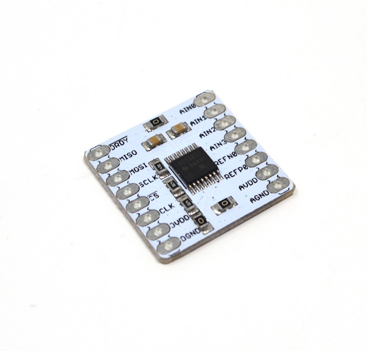
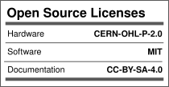

# ProtoCentral ADS1220 24-bit ADC Breakout Board
[](https://github.com/Protocentral/Protocentral_ADS1220/actions?workflow=Compile+Examples)



If you don't already have one, you can buy the ProtoCentral ADS1220 24-bit ADC Breakout Board from: [ProtoCentral(Worldwide)](https://protocentral.com/product/ads1220-24-bit-4-channel-low-noise-adc-breakout-board/)

Why would you need a 24-bit ADC? When 16-bit is just not enough. If your design demands high precision analog measurements, this breakout board for the Texas Instruments [ADS1220](https://www.ti.com/product/ADS1220) 24-bit delta-sigma ADC can get the job done. The ADS1220 gets rid of almost all external components with an internal voltage reference and internal clock, and adds a built-in PGA, temperature sensor and two matched current sources for sensor excitation — making it one of the easiest to use 24-bit ADCs around.

This Arduino library provides a modern, fully-featured driver for the ADS1220.

## Features

* 24-bit, 4-channel (2 differential / 4 single-ended) delta-sigma ADC
* Programmable data rates: 20 SPS up to 2 kSPS (Turbo mode)
* Programmable gain amplifier (PGA): 1 V/V to 128 V/V
* Internal 2.048 V reference, internal oscillator, internal temperature sensor
* Two matched IDAC current sources (10 µA – 1.5 mA) for RTD/sensor excitation
* 50/60 Hz FIR notch filter and low-side power switch
* Low current (~250 µA) and low noise (90 nVRMS at 20 SPS)

### Library highlights

* Typed `enum` / `struct` configuration API (no more raw register magic numbers)
* Blocking and non-blocking (`...Async`) reads
* Automatic raw-counts → voltage conversion from the active reference and gain
* Internal temperature-sensor readout in °C
* Per-instance SPI bus selection and ESP32 custom-pin `begin(sck, miso, mosi)`

## Applications

* High-precision analog voltage measurement
* PT100 / PT1000 RTD temperature measurement
* Strain-gauge load cells and Wheatstone-bridge sensors
* High-precision chemical and industrial sensors

## Installation

Install **ProtoCentral ADS1220** from the Arduino Library Manager, or download this
repository as a ZIP and use *Sketch → Include Library → Add .ZIP Library...*.

## Wiring to your Arduino

| ADS1220 Pin | Function       | Arduino Uno | ESP32 (VSPI) |
|-------------|:--------------:|:-----------:|:------------:|
| DRDY        | Data Ready     | D2          | D2 / D4      |
| MISO        | SPI Data Out   | D12         | D19          |
| MOSI        | SPI Data In    | D11         | D23          |
| SCLK        | SPI Clock      | D13         | D18          |
| CS          | Chip Select    | D7          | D7 / D5      |
| DVDD        | Digital VDD    | +5V         | +3.3V        |
| DGND        | Digital Ground | GND         | GND          |
| AVDD        | Analog VDD     | +5V         | +3.3V        |
| AGND        | Analog Ground  | GND         | GND          |
| AIN0–AIN3   | Analog Inputs  | Signals     | Signals      |

## Quick start

```cpp
#include "Protocentral_ADS1220.h"

#define ADS1220_CS_PIN    7
#define ADS1220_DRDY_PIN  2

Protocentral_ADS1220 ads1220(ADS1220_CS_PIN, ADS1220_DRDY_PIN);

void setup() {
    Serial.begin(115200);
    if (!ads1220.begin()) {
        Serial.println("ADS1220 not detected!");
        while (1);
    }
    ads1220.setInputMux(ADS1220_MUX_AIN0_AIN1);   // differential AIN0 - AIN1
    ads1220.setGain(ADS1220_GAIN_1);
    ads1220.setDataRate(ADS1220_DR_330SPS);
    ads1220.setReference(ADS1220_REF_INTERNAL_2V048);
    ads1220.setConversionMode(false);             // single-shot
}

void loop() {
    float mv = ads1220.readVoltage() * 1000.0;
    Serial.println(mv, 4);
    delay(200);
}
```

## Examples

| # | Example | Showcases |
|---|---------|-----------|
| 01 | [Basic-SingleEnded-Read](examples/01-Basic-SingleEnded-Read) | Single-ended scan of AIN0–AIN3, voltage conversion |
| 02 | [Differential-Continuous-Stream](examples/02-Differential-Continuous-Stream) | Continuous mode, DRDY interrupt, async reads |
| 03 | [Internal-Temperature-Sensor](examples/03-Internal-Temperature-Sensor) | On-chip temperature sensor in °C/°F |
| 04 | [High-Resolution-PGA](examples/04-High-Resolution-PGA) | PGA gain sweep 1×→128×, microvolt resolution |
| 05 | [RTD-PT100-3Wire](examples/05-RTD-PT100-3Wire) | 3-wire PT100 with dual IDAC sources, ratiometric reference |
| 06 | [Loadcell-Wheatstone-Bridge](examples/06-Loadcell-Wheatstone-Bridge) | Ratiometric bridge/load-cell sensing with tare |
| 07 | [Register-Dump-Diagnostics](examples/07-Register-Dump-Diagnostics) | `ADS1220_Config`, register dump, diagnostic MUX |
| 08 | [ESP32-MultiSPI](examples/08-ESP32-MultiSPI) | Custom SPI bus and ESP32 `begin(sck, miso, mosi)` |

To compile all examples locally with `arduino-cli`:

```bash
cd examples
./compile_examples.sh                 # defaults to arduino:avr:uno
./compile_examples.sh esp32:esp32:esp32
```

## API overview

```cpp
// Construction
Protocentral_ADS1220 ads1220();                          // default pins (CS 7, DRDY 2)
Protocentral_ADS1220 ads1220(csPin, drdyPin);
Protocentral_ADS1220 ads1220(csPin, drdyPin, &SPI1);     // custom SPI bus

// Initialisation
bool begin(bool startSPI = true);
bool begin(const ADS1220_Config& config, bool startSPI = true);
bool begin(uint8_t sck, uint8_t miso, uint8_t mosi);     // ESP32

// Configuration
setDataRate, setOperatingMode, setGain, enablePGA, setInputMux,
setReference, setReferenceVoltage, setFIRFilter, setConversionMode,
enableTemperatureSensor, enableBurnoutSources,
setIDACCurrent, setIDAC1Route, setIDAC2Route,
enableLowSideSwitch, setDRDYOnDOUT

// Acquisition
startConversion, stopConversion, isDataReady,
readRaw, readVoltage, readRawAsync, readVoltageAsync,
readSingleEnded, readTemperature

// Utility
reset, testConnection, writeRegister, readRegister,
getConfigRegisters, printRegisters,
countsToVoltage, voltageToCounts, getLibraryVersion
```

## Migrating from v1.x

Version 2.0.0 is a clean rewrite with a new API; sketches written for v1.x will
not compile unchanged. The mapping is direct:

| v1.x | v2.0.0 |
|------|--------|
| `pc_ads1220.begin(cs, drdy)` | `ads1220.begin()` (pins go to the constructor) |
| `set_data_rate(DR_330SPS)` | `setDataRate(ADS1220_DR_330SPS)` |
| `set_pga_gain(PGA_GAIN_1)` | `setGain(ADS1220_GAIN_1)` |
| `select_mux_channels(MUX_AIN0_AIN1)` | `setInputMux(ADS1220_MUX_AIN0_AIN1)` |
| `set_conv_mode_continuous()` | `setConversionMode(true)` |
| `Read_SingleShot_SingleEnded_WaitForData(MUX_SE_CH0)` | `readSingleEnded(0)` |
| `Read_Data_Samples()` / `Read_WaitForData()` | `readRaw()` / `readVoltage()` |
| `internal_reference()` | `setReference(ADS1220_REF_INTERNAL_2V048)` |

License Information
===================



This product is open source! Both, our hardware and software are open source and licensed under the following licenses:

Hardware
---------

**All hardware is released under the [CERN-OHL-P v2](https://ohwr.org/cern_ohl_p_v2.txt)** license.

Copyright CERN 2020.

This source describes Open Hardware and is licensed under the CERN-OHL-P v2.

You may redistribute and modify this documentation and make products
using it under the terms of the CERN-OHL-P v2 (https:/cern.ch/cern-ohl).
This documentation is distributed WITHOUT ANY EXPRESS OR IMPLIED
WARRANTY, INCLUDING OF MERCHANTABILITY, SATISFACTORY QUALITY
AND FITNESS FOR A PARTICULAR PURPOSE. Please see the CERN-OHL-P v2
for applicable conditions

Software
--------

**All software is released under the MIT License(http://opensource.org/licenses/MIT).**

THE SOFTWARE IS PROVIDED "AS IS", WITHOUT WARRANTY OF ANY KIND, EXPRESS OR IMPLIED, INCLUDING BUT NOT LIMITED TO THE WARRANTIES OF MERCHANTABILITY, FITNESS FOR A PARTICULAR PURPOSE AND NONINFRINGEMENT. IN NO EVENT SHALL THE AUTHORS OR COPYRIGHT HOLDERS BE LIABLE FOR ANY CLAIM, DAMAGES OR OTHER LIABILITY, WHETHER IN AN ACTION OF CONTRACT, TORT OR OTHERWISE, ARISING FROM, OUT OF OR IN CONNECTION WITH THE SOFTWARE OR THE USE OR OTHER DEALINGS IN THE SOFTWARE.

Documentation
-------------
**All documentation is released under [Creative Commons Share-alike 4.0 International](http://creativecommons.org/licenses/by-sa/4.0/).**


You are free to:

* Share — copy and redistribute the material in any medium or format
* Adapt — remix, transform, and build upon the material for any purpose, even commercially.
The licensor cannot revoke these freedoms as long as you follow the license terms.

Under the following terms:

* Attribution — You must give appropriate credit, provide a link to the license, and indicate if changes were made. You may do so in any reasonable manner, but not in any way that suggests the licensor endorses you or your use.
* ShareAlike — If you remix, transform, or build upon the material, you must distribute your contributions under the same license as the original.

Please check [*LICENSE.md*](LICENSE.md) for detailed license descriptions.
